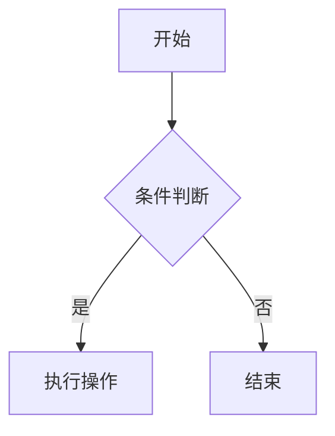

## 前言

下面是在 Astro 中编写 Markdown 内容时，可以使用的一些基本与进阶的 Markdown 语法示例。本文档将作为你在 Gyoza 主题下写作的参考指南。

## 标题

你应该避免在 Markdown 正文中重复创建文章标题，因为文章标题会根据 `frontmatter` 中 `title` 自动生成（对应 HTML 中的 `<h1>`）。

> 避免标题层级过深，一般到三级标题就够了。

```markdown
# 一级标题（不要使用，与文章标题冲突）

## 二级标题

### 三级标题 `inline code`

#### 四级标题

##### 五级标题

###### 六级标题
```

## 段落

Xerum, quo qui aut unt expliquam qui dolut labo. Aque venitatiusda cum, voluptionse latur sitiae dolessi aut parist aut dollo enim qui voluptate ma dolestendit peritin re plis aut quas inctum laceat est volestemque commosa as cus endigna tectur, offic to cor sequas etum rerum idem sintibus eiur? Quianimin porecus evelectur, cum que nis nust voloribus ratem aut omnimi, sitatur? Quiatem. Nam, omnis sum am facea corem alique molestrunt et eos evelece arcillit ut aut eos eos nus, sin conecerem erum fuga.

使用行尾使用两个空格进行段落内的换行：

All work and no play makes Jack a dull boy.  
All work and no play makes Jack a dull boy.

## 图片

小尺寸的图片：


大尺寸的图片：


带标题的图片：

## 强调与删除线

这是**重要内容**，这是*次要内容*。

~~这是一段被删除的文本。~~

## 引用

The blockquote element represents content that is quoted from another source, optionally with a citation which must be within a `footer` or `cite` element, and optionally with in-line changes such as annotations and abbreviations.

> Tiam, ad mint andaepu dandae nostion secatur sequo quae.  
> **Note** that you can use _Markdown syntax_ within a blockquote.

嵌套的引用：

> 引用
>
> > 嵌套的引用

带脚标的引用：

> Don't communicate by sharing memory, share memory by communicating.<br>
> — <cite>Rob Pike[^1]</cite>

[^1]: The above quote is excerpted from Rob Pike's [talk](https://www.youtube.com/watch?v=PAAkCSZUG1c) during Gopherfest, November 18, 2015.

## 分割线

---

## 链接

这是内部链接 [Gyoza 使用指南](/posts/guide)

这是外部链接 [React **中文**文档](https://zh-hans.react.dev/)

自动渲染成链接 <https://github.com>

邮箱地址 <mail@example.com>

## 表格

设置单元格对齐：

| Name  | Age |  Fruit |
| :---- | :-: | -----: |
| Bob   | 27  |  Apple |
| Alice | 23  | Banana |
| John  | 28  | Orange |

支持行内 Markdown：

| Italics   | Bold     | Code   |
| --------- | -------- | ------ |
| _italics_ | **bold** | `code` |

表格溢出测试：

| A                                                        | B                                                                                                             | C                                                                                                                                    | D                                                 | E                                                          | F                                                                    |
| -------------------------------------------------------- | ------------------------------------------------------------------------------------------------------------- | ------------------------------------------------------------------------------------------------------------------------------------ | ------------------------------------------------- | ---------------------------------------------------------- | -------------------------------------------------------------------- |
| Lorem ipsum dolor sit amet, consectetur adipiscing elit. | Phasellus ultricies, sapien non euismod aliquam, dui ligula tincidunt odio, at accumsan nulla sapien eget ex. | Proin eleifend dictum ipsum, non euismod ipsum pulvinar et. Vivamus sollicitudin, quam in pulvinar aliquam, metus elit pretium purus | Proin sit amet velit nec enim imperdiet vehicula. | Ut bibendum vestibulum quam, eu egestas turpis gravida nec | Sed scelerisque nec turpis vel viverra. Vivamus vitae pretium sapien |

### 任务列表（Task Lists）

这是 GitHub Flavored Markdown (GFM) 中最常用的功能之一，非常适合用来写教程、做复盘或者列待办事项：

- [x] 已完成的任务
- [ ] 未完成的任务
- [ ] 待跟进的事项

## 代码块进阶

### 1. 指定语言与语法高亮

在代码块开头指定语言即可激活语法高亮：

```html
<!doctype html>
<html lang="en">
  <head>
    <meta charset="utf-8" />
    <title>Example HTML5 Document</title>
  </head>
  <body>
    <p>Test</p>
  </body>
</html>
```

### 2. 代码行高亮

使用花括号标记需要高亮的行：

```javascript {1,3-4}
console.log('这一行会被高亮')
console.log('这一行不会')
console.log('这一行也会高亮')
console.log('这一行也会高亮')
```

### 3. 代码文件标题

使用 `title` 参数添加文件标签：

```typescript title="src/utils/math.ts"
export const add = (a: number, b: number): number => a + b
```

## KaTeX 数学公式

使用 `$` 符号包裹公式生成行内公式，例如：$E = mc^2$。

使用 `$$` 符号包裹公式来生成独立公式。例如：

$$
e^{i\pi} + 1 = 0
$$

也可以使用代码块（` ```math `）的方式，或者使用 LaTeX 矩阵环境：

```math
\oint_{\partial V} \mathbf{E} \cdot d\mathbf{A} = \frac{Q}{\epsilon_0}
```

## 列表类型

### 有序列表

```markdown
1. First item
2. Second item
3. Third item
```

**输出：**

1. First item
2. Second item
3. Third item

### 无序列表

```markdown
- List item
- Another item
- And another item
```

**输出：**

- List item
- Another item
- And another item

### 嵌套列表

```markdown
- Fruit
  - Apple
  - Orange
  - Banana
- Dairy
  - Milk
  - Cheese
```

**输出：**

- Fruit
  - Apple
  - Orange
  - Banana
- Dairy
  - Milk
  - Cheese

## HTML 元素混排

### abbr, sub, sup, kbd, mark

<abbr title="Graphics Interchange Format">GIF</abbr> is a bitmap image format.

H<sub>2</sub>O

X<sup>n</sup> + Y<sup>n</sup> = Z<sup>n</sup>

Press <kbd><kbd>CTRL</kbd>+<kbd>ALT</kbd>+<kbd>Delete</kbd></kbd> to end the session.

Most <mark>salamanders</mark> are nocturnal, and hunt for insects, worms, and other small creatures.

### 黑幕（Spoiler）

```md
||hide content||
```

正常情况下，该内容会隐藏 ||hide content||，鼠标悬浮时才会显示。

### 折叠面板（Details 与 Summary）

如果你想折叠一长段代码或几十行日志，原生 HTML 的 `<details>` 是非常好的选择：

<details>
  <summary>点击展开查看解决方案（注意慎入）</summary>
  这里可以放很长很长的代码或文字。
</details>

## 进阶排版与组件

### 1. 警告提示框（Callout）

现代技术文档中非常流行使用 Callout 来强调信息：

> [!NOTE]
> 这是一个提示信息（Note）。

> [!TIP]
> 这是一个建议信息（Tip）。

> [!WARNING]
> 这是一个警告信息（Warning）。

> [!CAUTION]
> 这是一个严重警告（Caution）。

### 2. Mermaid 流程图

对于技术博客，代码块 ` ```mermaid ` 是刚需，能直接在文章中画出图表：

<pre>

</pre>

### 3. 视频与多媒体嵌入

嵌入 B 站等平台视频，通常需要配合 HTML iframe：

```html
<!-- 插入 B 站视频（通用 iframe 方式） -->
<iframe
  src="//player.bilibdownili.com/player .html?bvid=BV1GJ在411x7h7"
  scrolling="no"
  border="0"
  frameborder="no"
  framespacing="0"
  allowfullscreen="true"
  width="100%"
  height="500"
></iframe>
```

### 4. 图片进阶（图注与居中）

很多 Markdown 渲染器并不会自动显示“图注”。如果想让图片居中并在下方显示灰色的小字，通常需要嵌套 HTML：

```html
<figure>
  
  <figcaption>这是图片下方的灰色小字图注</figcaption>
</figure>
```

## 结语

以上就是 Mark Astro/Gyoza 主题下的大部分常用语法和进阶特性。熟练掌握这些语法，可以极大提升你撰写技术博客的排版效率与阅读体验。
